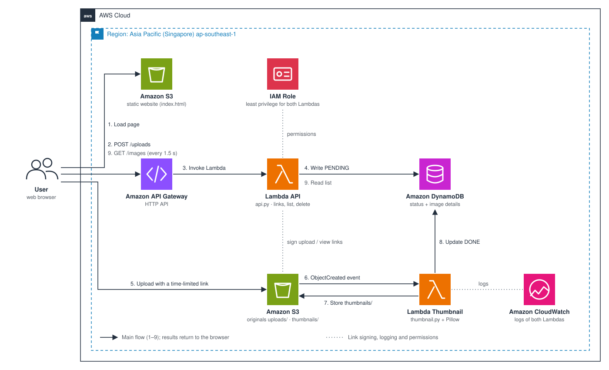

# SnapThumb
## An automatic image thumbnail service on AWS

# 1. Executive Summary

SnapThumb is a web app where users upload images and get thumbnails back within seconds. It follows an **event-driven architecture**: as soon as an image lands in Amazon S3, S3 emits an event and AWS Lambda runs automatically to create the thumbnail, with no server running all the time. The whole system is **serverless**, and the demo costs close to 0 USD per month.

# 2. Problem Statement

## Current Problem

- Phone photos are often 3–8 MB and 4000 px or more wide.
- Showing originals in lists, galleries or product pages makes pages slow and wastes bandwidth, especially on mobile networks.
- Resizing on an always-on server means paying for it when nobody uploads, and handling bursts yourself.

## Solution

- Users upload images **directly from the browser to Amazon S3** with a time-limited link (presigned POST).
- S3 triggers **AWS Lambda** for each new image; Lambda uses Pillow to create a 320 px thumbnail and stores it back in S3.
- Image details (status, dimensions, size, processing time) are written to **Amazon DynamoDB** for the UI.

## Benefits

- Thumbnails are about 90–98% smaller than originals, so pages load faster.
- Pay only when images are processed; idle cost is close to zero.
- Scales automatically: 1 or 100 images at once, Lambda runs them in parallel.
- New processing steps (compression, watermarking, detection) can be added without touching the upload path.

# 3. Solution Architecture

## Solution Architecture

**Main flow (1–9):**

1. The user loads the static web page from Amazon S3.
2. The page sends `POST /uploads` (file name, type, size) to Amazon API Gateway.
3. API Gateway invokes the **API Lambda**.
4. The API Lambda validates the file, writes a `PENDING` record to DynamoDB and returns an upload link valid for 5 minutes.
5. The browser uploads the image directly to S3, under `uploads/`.
6. S3 emits an `ObjectCreated` event and invokes the **Thumbnail Lambda**.
7. The Thumbnail Lambda reads the original, creates the thumbnail and stores it under `thumbnails/`.
8. The Thumbnail Lambda updates the DynamoDB record to `DONE` with dimensions, sizes and processing time.
9. The page calls `GET /images` every 1.5 seconds; once the image is done, the API Lambda returns view links valid for 1 hour and the thumbnail appears.

**Monitoring and security:** both Lambda functions log to Amazon CloudWatch. Each function has its own IAM role with only the permissions it needs. The image bucket is not public.

## AWS Services Used

| Service | Layer | Role |
| --- | --- | --- |
| Amazon S3 (web bucket) | Frontend | Hosts the static web UI |
| Amazon API Gateway | API | HTTPS endpoints `POST /uploads`, `GET /images`, `DELETE /images/{id}`; CORS; throttling |
| AWS Lambda (API) | Backend | Validates files, signs time-limited upload/view links, lists and deletes images |
| Amazon S3 (image bucket) | Backend | Stores originals (`uploads/`) and thumbnails (`thumbnails/`); emits events on new images |
| AWS Lambda (Thumbnail) | Backend | Creates thumbnails with Pillow |
| Amazon DynamoDB | Backend | Stores each image's status and details |
| Amazon CloudWatch | Monitoring | Logs and metrics for both Lambda functions |
| AWS IAM | Security | Least-privilege permissions per function |
| AWS CloudFormation | Deployment | Creates and deletes all infrastructure from code |

## Component Design

### Frontend
- A single plain `index.html` (HTML, CSS, JavaScript): drag-and-drop for multiple images, gallery, per-image status.
- Checks file type (JPEG, PNG, WebP) and size (up to 10 MB) before upload.

### Backend
- **API Lambda** (Python 3.12): three routes; issues presigned POSTs with conditions on file type and size, so S3 itself rejects invalid files.
- **Thumbnail Lambda** (Python 3.12 + Pillow): keeps the aspect ratio, honours EXIF rotation, flattens transparent PNGs onto white, never enlarges small images, outputs JPEG at quality 85.
- Originals and thumbnails live under different prefixes; the trigger listens only to `uploads/`, so there is no infinite loop.

### Data
- DynamoDB, partition key `id`, on-demand capacity. Each image stores file name, status (`PENDING`, `DONE`, `FAILED`), dimensions and sizes before/after, and processing time.

### Security
- The image bucket blocks all public access; images are viewable only through time-limited links.
- Upload links expire after 5 minutes and are limited to 10 MB and allowed types.
- API Gateway is throttled to 10 requests per second.

# 4. Technical Implementation

## Implementation Phases

1. Prepare the account, region and cost alerts.
2. Create the image bucket, DynamoDB table and Pillow layer.
3. Create the Thumbnail Lambda and S3 trigger.
4. Create the API Lambda and API Gateway.
5. Write and host the web UI.
6. Automate with CloudFormation; test, monitor, clean up.

## Technical Requirements

### Programming Languages
- Python 3.12 (Lambda)
- HTML, CSS, JavaScript (UI)

### Libraries
- boto3 (included in Lambda), Pillow 11 (image processing), moto (mocked AWS for tests)

### Tools
- AWS Management Console, AWS CloudShell, AWS CLI, Visual Studio Code, Git, Hugo

# 5. Timeline & Milestones

| Week | Work |
| --- | --- |
| 1–5 | AWS fundamentals: IAM, VPC, EC2, S3, RDS, DynamoDB, Lambda, API Gateway |
| 6 | Event-driven architecture, choosing the project, writing the proposal |
| 7 | Image bucket, DynamoDB, Pillow packaging |
| 8 | Thumbnail Lambda and S3 trigger |
| 9 | API Lambda, API Gateway and web UI |
| 10 | Automation with CloudFormation; testing |
| 11 | Write the workshop; publish the report on GitHub Pages |
| 12 | Demo, cleanup, wrap-up |

# 6. Budget Estimation

## Infrastructure Cost Estimate

Assumptions: ap-southeast-1; 1,000 images/month of about 3 MB each; each image viewed about 20 times.

| Item | Estimated cost (USD/month) |
| --- | --- |
| Amazon S3 (about 3 GB originals + thumbnails, requests) | ~0.08 |
| AWS Lambda (1,000 thumbnails × ~1 s × 1 GB, plus API calls) | ~0.00 (Free Tier) |
| Amazon DynamoDB on-demand (tens of thousands of reads/writes) | ~0.01 |
| Amazon API Gateway HTTP API (about 25,000 requests) | ~0.03 |
| Amazon CloudWatch Logs | ~0.00 (Free Tier) |
| **Total** | **< 0.20** |

{}
These are estimates based on list prices, which can change. [Insert your AWS Pricing Calculator link here]
{}

### Cost Control Guidelines

- Create a 5 USD AWS Budget from day one.
- Delete all resources after the demo with `destroy.sh` (section 5.10).

# 7. Risk Assessment

## Risk Matrix

| Risk | Likelihood | Impact | Mitigation |
| --- | --- | --- | --- |
| Infinite loop: Lambda writes to the bucket and triggers itself | Medium | High | Trigger listens only to `uploads/`; thumbnails go to `thumbnails/` |
| Malicious or oversized uploads | Medium | Medium | Presigned POST limits type and size to 10 MB; Lambda marks unreadable files `FAILED` |
| User images exposed | Low | High | Private bucket; view links expire after 1 hour |
| Unexpected charges | Low | Medium | AWS Budgets, API throttling, cleanup after the demo |
| Missing service quota on a new account | Low | High | Use only core services; check quotas before choosing an architecture |

# 8. Expected Outcomes

## Technical Outcomes

- A working web app: upload multiple images, get thumbnails in 1–3 seconds, view and delete them.
- Thumbnails at least 90% smaller than phone photos.
- All infrastructure rebuilt with one command; automated tests included.

## Practical Value

- Applies to any image-heavy system: galleries, online shops, profile photos in a student management system.
- A foundation for further image-processing steps using the same event-driven pattern.
