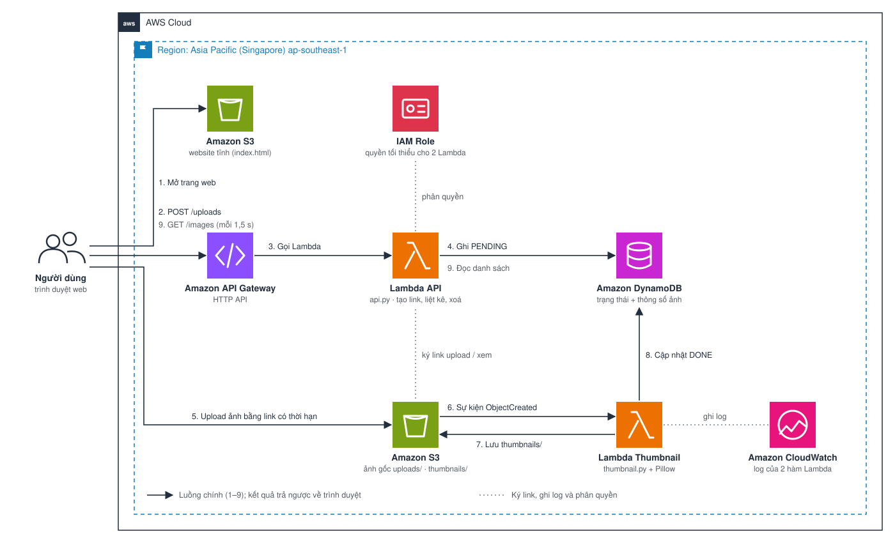

# SnapThumb
## Dịch vụ tạo ảnh thu nhỏ tự động trên AWS

# 1. Tóm tắt

SnapThumb là một ứng dụng web cho phép người dùng tải ảnh lên và nhận lại ảnh thu nhỏ (thumbnail) chỉ sau vài giây. Hệ thống xây dựng theo **kiến trúc hướng sự kiện (event-driven)**: ngay khi ảnh được lưu vào Amazon S3, S3 phát ra một sự kiện và AWS Lambda tự động chạy để tạo ảnh thu nhỏ, không cần máy chủ nào chạy thường trực. Toàn bộ hệ thống là **serverless**, chi phí cho bản demo gần như 0 USD/tháng.

# 2. Vấn đề

## Vấn đề hiện tại

- Ảnh chụp từ điện thoại thường nặng 3–8 MB, kích thước 4000 px trở lên.
- Hiển thị ảnh gốc trong danh sách, thư viện hay trang sản phẩm làm trang web tải chậm và tốn băng thông, nhất là trên mạng di động.
- Nếu thu nhỏ ảnh trên một máy chủ thường trực, phải trả tiền máy chủ cả khi không có ai upload và phải tự xử lý lúc có nhiều ảnh cùng lúc.

## Giải pháp

- Người dùng upload ảnh **thẳng từ trình duyệt lên Amazon S3** bằng link có thời hạn (presigned POST).
- S3 kích hoạt **AWS Lambda** cho mỗi ảnh mới; Lambda dùng thư viện Pillow tạo ảnh thu nhỏ 320 px và lưu lại vào S3.
- Thông tin ảnh (trạng thái, kích thước, dung lượng, thời gian xử lý) được ghi vào **Amazon DynamoDB** để giao diện hiển thị.

## Lợi ích

- Ảnh thu nhỏ nhẹ hơn ảnh gốc khoảng 90–98%, trang web tải nhanh hơn.
- Chỉ trả tiền khi có ảnh được xử lý; không có ảnh thì gần như không tốn phí.
- Tự mở rộng: 1 ảnh hay 100 ảnh cùng lúc, Lambda tự chạy song song.
- Dễ mở rộng thêm bước xử lý khác (nén, đóng dấu, nhận diện) mà không sửa phần upload.

# 3. Kiến trúc giải pháp

## Kiến trúc giải pháp

**Luồng chính (1–9):**

1. Người dùng mở trang web tĩnh lưu trên Amazon S3.
2. Trang web gửi `POST /uploads` (tên file, loại, dung lượng) tới Amazon API Gateway.
3. API Gateway gọi hàm **Lambda API**.
4. Lambda API kiểm tra file, ghi bản ghi trạng thái `PENDING` vào DynamoDB và trả về một link upload có thời hạn 5 phút.
5. Trình duyệt upload ảnh thẳng lên S3, vào thư mục `uploads/`.
6. S3 phát sự kiện `ObjectCreated` và kích hoạt hàm **Lambda Thumbnail**.
7. Lambda Thumbnail đọc ảnh gốc, tạo ảnh thu nhỏ và lưu vào `thumbnails/`.
8. Lambda Thumbnail cập nhật bản ghi trong DynamoDB thành `DONE` kèm kích thước, dung lượng và thời gian xử lý.
9. Trang web hỏi `GET /images` mỗi 1,5 giây; khi ảnh xong, Lambda API trả về link xem ảnh có thời hạn 1 giờ và ảnh thu nhỏ hiện lên.

**Giám sát và bảo mật:** hai hàm Lambda ghi log vào Amazon CloudWatch. Mỗi hàm có IAM role riêng chỉ với quyền cần dùng. Bucket ảnh không public.

## Các dịch vụ AWS sử dụng

| Dịch vụ | Thuộc phần | Vai trò |
| --- | --- | --- |
| Amazon S3 (bucket web) | Frontend | Host giao diện web tĩnh |
| Amazon API Gateway | API | Endpoint HTTPS `POST /uploads`, `GET /images`, `DELETE /images/{id}`; CORS; giới hạn tần suất |
| AWS Lambda (API) | Backend | Kiểm tra file, tạo link upload/xem có thời hạn, liệt kê và xoá ảnh |
| Amazon S3 (bucket ảnh) | Backend | Lưu ảnh gốc (`uploads/`) và ảnh thu nhỏ (`thumbnails/`), phát sự kiện khi có ảnh mới |
| AWS Lambda (Thumbnail) | Backend | Tạo ảnh thu nhỏ bằng Pillow |
| Amazon DynamoDB | Backend | Lưu trạng thái và thông số của từng ảnh |
| Amazon CloudWatch | Giám sát | Log và số liệu của hai hàm Lambda |
| AWS IAM | Bảo mật | Quyền tối thiểu cho từng hàm |
| AWS CloudFormation | Triển khai | Tạo và xoá toàn bộ hạ tầng bằng code |

## Thiết kế thành phần

### Frontend
- Một file `index.html` thuần (HTML, CSS, JavaScript): kéo thả nhiều ảnh, thư viện ảnh, trạng thái từng ảnh.
- Kiểm tra trước loại file (JPEG, PNG, WebP) và dung lượng (tối đa 10 MB).

### Backend
- **Lambda API** (Python 3.12): ba route, sinh presigned POST có điều kiện về loại file và dung lượng, nên S3 tự từ chối file không hợp lệ.
- **Lambda Thumbnail** (Python 3.12 + Pillow): giữ đúng tỉ lệ, xoay theo EXIF, đặt PNG trong suốt lên nền trắng, không phóng to ảnh nhỏ, xuất JPEG chất lượng 85.
- Ảnh gốc và ảnh thu nhỏ nằm ở hai tiền tố khác nhau; trigger chỉ lắng nghe `uploads/` nên không có vòng lặp vô hạn.

### Dữ liệu
- DynamoDB, khoá chính `id`, chế độ on-demand. Mỗi ảnh lưu: tên file, trạng thái (`PENDING`, `DONE`, `FAILED`), kích thước và dung lượng trước/sau, thời gian xử lý.

### Bảo mật
- Bucket ảnh chặn mọi truy cập công khai; chỉ xem được qua link có thời hạn.
- Link upload hết hạn sau 5 phút, giới hạn 10 MB và đúng loại file.
- API Gateway giới hạn 10 request/giây.

# 4. Triển khai kỹ thuật

## Các giai đoạn triển khai

1. Chuẩn bị tài khoản, region và cảnh báo chi phí.
2. Tạo bucket ảnh, bảng DynamoDB và layer Pillow.
3. Tạo Lambda Thumbnail và trigger S3.
4. Tạo Lambda API và API Gateway.
5. Viết và host giao diện web.
6. Tự động hoá bằng CloudFormation, kiểm thử, giám sát, dọn dẹp.

## Yêu cầu kỹ thuật

### Ngôn ngữ lập trình
- Python 3.12 (Lambda)
- HTML, CSS, JavaScript (giao diện)

### Thư viện
- boto3 (có sẵn trong Lambda), Pillow 11 (xử lý ảnh), moto (giả lập AWS khi test)

### Công cụ
- AWS Management Console, AWS CloudShell, AWS CLI, Visual Studio Code, Git, Hugo

# 5. Lộ trình & Các mốc

| Tuần | Công việc |
| --- | --- |
| 1–5 | Học nền tảng AWS: IAM, VPC, EC2, S3, RDS, DynamoDB, Lambda, API Gateway |
| 6 | Tìm hiểu kiến trúc hướng sự kiện, chọn đề tài, viết bản đề xuất |
| 7 | Bucket ảnh, DynamoDB, đóng gói Pillow |
| 8 | Lambda Thumbnail và trigger S3 |
| 9 | Lambda API, API Gateway và giao diện web |
| 10 | Tự động hoá bằng CloudFormation, kiểm thử |
| 11 | Viết workshop, đưa báo cáo lên GitHub Pages |
| 12 | Demo, dọn dẹp, tổng kết |

# 6. Ước tính chi phí

## Ước tính chi phí hạ tầng

Giả định: region ap-southeast-1; 1.000 ảnh/tháng, mỗi ảnh khoảng 3 MB; mỗi ảnh được xem khoảng 20 lần.

| Hạng mục | Chi phí ước tính (USD/tháng) |
| --- | --- |
| Amazon S3 (khoảng 3 GB ảnh gốc + thumbnail, request) | ~0.08 |
| AWS Lambda (1.000 lần tạo thumbnail × ~1 giây × 1 GB, cùng các lần gọi API) | ~0.00 (Free Tier) |
| Amazon DynamoDB on-demand (vài chục nghìn lượt đọc/ghi) | ~0.01 |
| Amazon API Gateway HTTP API (khoảng 25.000 request) | ~0.03 |
| Amazon CloudWatch Logs | ~0.00 (Free Tier) |
| **Tổng** | **< 0.20** |

{}
Giá trên là ước tính theo giá niêm yết và có thể thay đổi. [Chèn link AWS Pricing Calculator của bạn tại đây]
{}

### Hướng dẫn kiểm soát chi phí

- Tạo AWS Budgets 5 USD ngay từ đầu.
- Xoá toàn bộ tài nguyên sau khi demo bằng `destroy.sh` (mục 5.10).

# 7. Đánh giá rủi ro

## Ma trận rủi ro

| Rủi ro | Khả năng | Ảnh hưởng | Cách xử lý |
| --- | --- | --- | --- |
| Vòng lặp vô hạn: Lambda ghi vào bucket rồi tự kích hoạt lại | Trung bình | Cao | Trigger chỉ lắng nghe `uploads/`, thumbnail ghi vào `thumbnails/` |
| Upload file độc hại hoặc quá lớn | Trung bình | Trung bình | Presigned POST giới hạn loại file và 10 MB; Lambda đánh dấu `FAILED` nếu không đọc được ảnh |
| Lộ ảnh của người dùng | Thấp | Cao | Bucket private, link xem hết hạn sau 1 giờ |
| Phát sinh chi phí ngoài ý muốn | Thấp | Trung bình | AWS Budgets, giới hạn tần suất API, dọn tài nguyên sau demo |
| Thiếu quota dịch vụ trên tài khoản mới | Thấp | Cao | Chỉ dùng các dịch vụ cơ bản; kiểm tra quota trước khi chọn kiến trúc |

# 8. Kết quả mong đợi

## Kết quả kỹ thuật

- Ứng dụng web chạy được: upload nhiều ảnh, nhận thumbnail trong 1–3 giây, xem và xoá ảnh.
- Ảnh thu nhỏ nhẹ hơn ảnh gốc ít nhất 90% với ảnh chụp điện thoại.
- Toàn bộ hạ tầng dựng lại được bằng một lệnh; có bộ test tự động.

## Giá trị thực tế

- Áp dụng được cho các hệ thống có nhiều ảnh: thư viện ảnh, trang bán hàng, ảnh đại diện trong hệ thống quản lý sinh viên.
- Là nền tảng để thêm các bước xử lý ảnh khác theo cùng mô hình hướng sự kiện.
