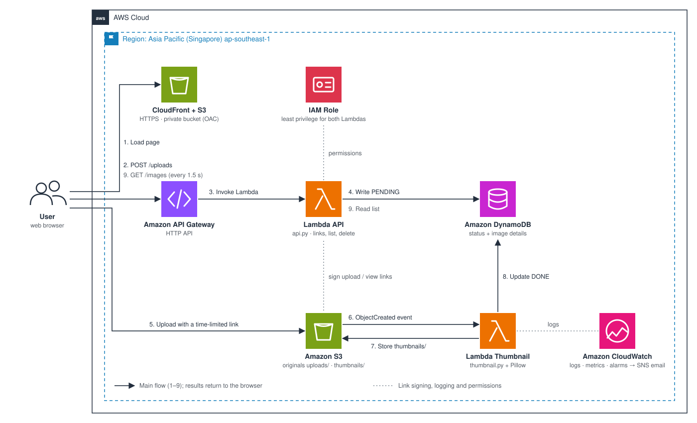

## How SnapThumb works

The system has two Lambda functions with different jobs:

| Component | AWS service | What it does |
| --- | --- | --- |
| Web page | **Amazon S3** (static website) | Drag-and-drop upload and a gallery of thumbnails |
| Front door | **Amazon API Gateway** | HTTPS endpoints the page calls |
| API Lambda | **AWS Lambda** | Validates files, signs time-limited upload and view links, lists and deletes images |
| Image storage | **Amazon S3** (private bucket) | Originals under `uploads/`, thumbnails under `thumbnails/` |
| Thumbnail Lambda | **AWS Lambda** + Pillow | Runs automatically for each new image and creates its thumbnail |
| Image records | **Amazon DynamoDB** | Status (`PENDING` → `DONE` / `FAILED`), dimensions, sizes, processing time |
| Logs | **Amazon CloudWatch** | Every run of both functions |
| Alerts (admin only) | **CloudWatch alarms + Amazon SNS** | Email the administrator when the thumbnail function crashes, the API returns 5xx, or many uploads fail |

The numbers in the diagram follow the data flow: (1) open the web page, (2) `POST /uploads`, (3) API Gateway calls the API Lambda, (4) it writes a `PENDING` record and returns a signed link, (5) the browser uploads straight to S3, (6) the `ObjectCreated` event calls the thumbnail Lambda, (7) it saves the thumbnail in `thumbnails/`, (8) updates the record to `DONE`, (9) the page lists images with `GET /images`. CloudWatch collects logs, metrics and alarms throughout.

## Why these services

| Need | Chosen service | Why | Alternative considered |
| --- | --- | --- | --- |
| Store originals and thumbnails, notify on new files | **Amazon S3** | Unlimited, cheap storage; built-in Event Notifications start the processing; presigned POST lets the browser upload directly with size and type limits | Disk on EC2 / EFS: needs a running server and has no built-in "new file" event |
| Process each image | **AWS Lambda** | Runs only when an image arrives, billed per millisecond, scales out automatically when many images arrive at once | EC2 or ECS worker: pays 24/7 even when idle, needs scaling and patching |
| HTTPS endpoints for the web page | **Amazon API Gateway – HTTP API** | Managed HTTPS, CORS and throttling with no server; cheaper and lower latency than REST API, and SnapThumb needs none of the REST-only features (API keys, request validation) | REST API (more features, higher price); ALB + EC2 (always-on cost) |
| Store each image's status and details | **Amazon DynamoDB (on-demand)** | Simple key–value access by `id`, millisecond latency, no server or connection pool to manage from Lambda, pay per request | Amazon RDS: always-on instance cost, schema and database connections from Lambda to manage |
| Logs, metrics and alerts | **Amazon CloudWatch** | Lambda and API Gateway send logs and metrics automatically; metric filters turn log lines into metrics; alarms watch them | Third-party monitoring: extra cost and agents |
| Send alert emails | **Amazon SNS** | An alarm can publish to an SNS topic with no code; email subscription needs only a confirmation click | Amazon SES: requires verifying a sender identity and writing code |
| Permissions | **AWS IAM** | One role per function with only the actions and resources it needs; no access keys in code | Shared admin role (violates least privilege) |
| Build and delete everything | **AWS CloudFormation** | Whole system as one template; same result every time; one command deletes everything so nothing keeps costing money; runs in CloudShell with no extra tools | AWS CDK / Terraform: need extra tooling and a build step |

## Security in the design

| Risk | What SnapThumb does |
| --- | --- |
| Someone reads other people's images | The image bucket blocks all public access; images are only shown through presigned links that expire after 1 hour |
| AWS keys leak | No access keys in code or in the browser; each Lambda function runs with its own IAM role |
| Permissions too broad | Each role has only the actions it needs, scoped to the table and to a prefix: the thumbnail function can only read `uploads/*`, write `thumbnails/*` and call `UpdateItem` |
| Malicious or oversized uploads | The API checks type and size; the presigned POST carries `Content-Type` and `content-length-range` conditions so S3 itself rejects other files; upload links expire after 5 minutes; Pillow checks the real file content |
| API abuse | Throttling of 10 requests/s (burst 20) on the HTTP API |
| Data at rest | S3 encrypts objects (SSE-S3, AES-256) and DynamoDB encrypts the table by default |
| Problems go unnoticed | CloudWatch alarms email the administrator through SNS (5.8) |

Known gaps for a demo: the API has no sign-in and the website bucket is public over HTTP. 5.8 lists how to close them (Cognito, CloudFront with Origin Access Control).

## Scalability

- **Amazon S3** stores any number of images, and browsers upload straight to it, so the API never carries image data and does not become a bottleneck.
- **AWS Lambda** runs one invocation per image and runs them in parallel: in the test, 6 images uploaded at once were processed by 5 instances at the same time. The limit is the account's Lambda concurrency in the region (see **Service Quotas**).
- **Amazon DynamoDB on-demand** adjusts throughput automatically; no capacity planning.
- At larger scale, `GET /images` should stop scanning the whole table (see *Limitations and next steps* in 5.8).

## Key concepts

#### Event-driven architecture
Nothing polls the bucket. When an object is created, S3 emits an **event** and invokes the Lambda function directly. The function runs only when there is work, and AWS runs many copies in parallel when many images arrive.

#### S3 Event Notifications
A bucket setting that says "when an object is created under this prefix, call this target". SnapThumb listens only to `uploads/`. Thumbnails are written to `thumbnails/`, so writing a thumbnail never triggers the function again. Without this split, the function would trigger itself in an endless loop.

#### Presigned URL / presigned POST
A link signed with the API Lambda's permissions that lets the browser upload one specific object directly to S3 for a short time (5 minutes). The browser never gets AWS credentials, and large files never pass through Lambda. The presigned POST also carries conditions: S3 rejects files that are not the declared type or are larger than 10 MB.

#### Lambda layer
A zip of libraries shared by functions. Pillow (the Python imaging library) is not included in the Lambda runtime, so you publish it once as a layer and attach it to the Thumbnail function.

#### DynamoDB on-demand
A NoSQL table billed per request, with no capacity to plan. Each image is one item keyed by `id`.

#### Metric filter and alarm
A **metric filter** counts log lines that match a pattern (for example `Failed to process`) and publishes the count as a CloudWatch metric. An **alarm** watches a metric and, when it crosses a threshold, sends a message to an Amazon SNS topic, which emails the subscribers.

{}
Test each part before moving on: upload a file to the bucket by hand and check that a thumbnail appears (5.5) → call the API with curl (5.6) → use the web page (5.7).
{}
