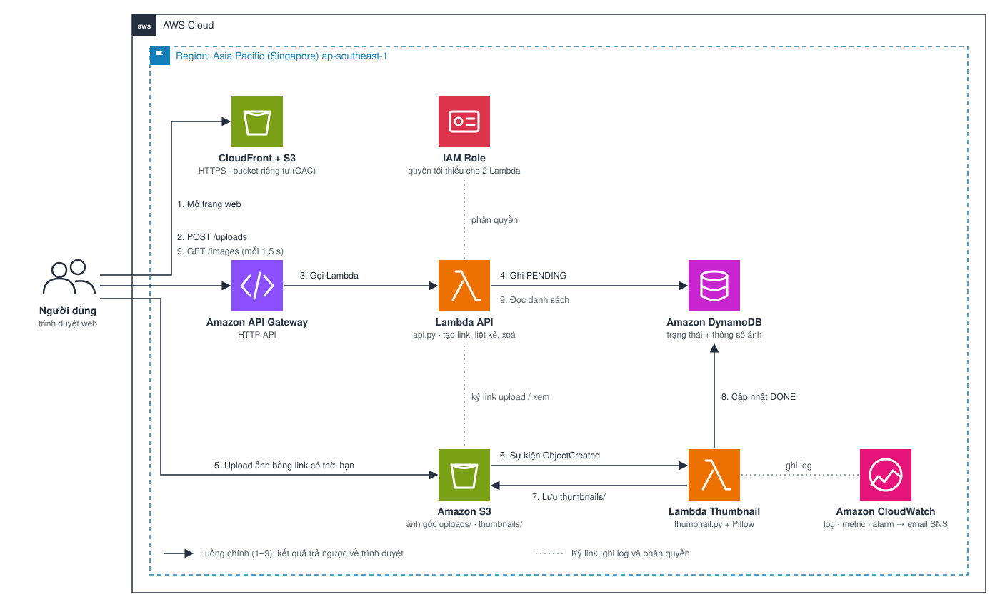

## SnapThumb hoạt động như thế nào

Hệ thống có hai hàm Lambda với hai nhiệm vụ khác nhau:

| Thành phần | Dịch vụ AWS | Nhiệm vụ |
| --- | --- | --- |
| Trang web | **Amazon S3** (website tĩnh) | Kéo thả ảnh để upload và hiển thị thư viện ảnh thu nhỏ |
| Cửa vào | **Amazon API Gateway** | Các endpoint HTTPS mà trang web gọi tới |
| Lambda API | **AWS Lambda** | Kiểm tra file, ký link upload và link xem có thời hạn, liệt kê và xoá ảnh |
| Kho ảnh | **Amazon S3** (bucket riêng tư) | Ảnh gốc ở `uploads/`, ảnh thu nhỏ ở `thumbnails/` |
| Lambda Thumbnail | **AWS Lambda** + Pillow | Tự chạy với mỗi ảnh mới và tạo ảnh thu nhỏ |
| Hồ sơ ảnh | **Amazon DynamoDB** | Trạng thái (`PENDING` → `DONE` / `FAILED`), kích thước, dung lượng, thời gian xử lý |
| Nhật ký | **Amazon CloudWatch** | Ghi lại mọi lần chạy của hai hàm |
| Cảnh báo (chỉ cho admin) | **CloudWatch alarm + Amazon SNS** | Gửi email cho người quản trị khi hàm thumbnail bị lỗi, API trả lỗi 5xx, hoặc nhiều ảnh xử lý thất bại |

Các số trong sơ đồ đi theo luồng dữ liệu: (1) mở trang web, (2) `POST /uploads`, (3) API Gateway gọi Lambda API, (4) Lambda ghi bản ghi `PENDING` và trả link có chữ ký, (5) trình duyệt upload thẳng lên S3, (6) sự kiện `ObjectCreated` gọi Lambda Thumbnail, (7) lưu thumbnail vào `thumbnails/`, (8) cập nhật bản ghi thành `DONE`, (9) trang web lấy danh sách bằng `GET /images`. CloudWatch thu thập log, metric và alarm trong suốt quá trình.

## Vì sao chọn các dịch vụ này

| Nhu cầu | Dịch vụ chọn | Lý do | Phương án đã cân nhắc |
| --- | --- | --- | --- |
| Lưu ảnh gốc và ảnh thu nhỏ, báo khi có file mới | **Amazon S3** | Dung lượng không giới hạn, giá rẻ; Event Notifications có sẵn để kích hoạt xử lý; presigned POST cho trình duyệt upload thẳng, có giới hạn dung lượng và loại file | Ổ đĩa trên EC2 / EFS: phải chạy máy chủ và không có sẵn sự kiện "có file mới" |
| Xử lý từng ảnh | **AWS Lambda** | Chỉ chạy khi có ảnh, tính tiền theo mili giây, tự chạy song song khi nhiều ảnh đến cùng lúc | Worker trên EC2 hoặc ECS: trả tiền 24/7 kể cả lúc rảnh, phải tự scale và vá lỗi hệ điều hành |
| Endpoint HTTPS cho trang web | **Amazon API Gateway – HTTP API** | HTTPS, CORS và giới hạn tần suất có sẵn, không cần máy chủ; rẻ và nhanh hơn REST API, mà SnapThumb không cần các tính năng chỉ REST API mới có (API key, kiểm tra request) | REST API (nhiều tính năng hơn, giá cao hơn); ALB + EC2 (tốn phí thường trực) |
| Lưu trạng thái và thông số từng ảnh | **Amazon DynamoDB (on-demand)** | Truy cập đơn giản theo `id`, độ trễ vài mili giây, không phải quản lý máy chủ hay kết nối database từ Lambda, trả tiền theo request | Amazon RDS: tốn phí instance thường trực, phải quản lý schema và kết nối từ Lambda |
| Log, số liệu và cảnh báo | **Amazon CloudWatch** | Lambda và API Gateway tự gửi log và metric; metric filter biến dòng log thành số liệu; alarm theo dõi số liệu đó | Công cụ giám sát bên thứ ba: tốn thêm phí và phải cài agent |
| Gửi email cảnh báo | **Amazon SNS** | Alarm gửi thẳng vào SNS topic, không cần viết code; đăng ký email chỉ cần bấm xác nhận | Amazon SES: phải xác minh địa chỉ gửi và viết code |
| Phân quyền | **AWS IAM** | Mỗi hàm một role, chỉ có đúng quyền và tài nguyên cần dùng; không có access key trong code | Dùng chung role quản trị (vi phạm nguyên tắc quyền tối thiểu) |
| Dựng và xoá toàn bộ hệ thống | **AWS CloudFormation** | Cả hệ thống trong một template, dựng lần nào cũng giống nhau; một lệnh xoá sạch để không phát sinh phí; chạy được ngay trong CloudShell | AWS CDK / Terraform: phải cài thêm công cụ và bước build |

## Bảo mật trong thiết kế

| Rủi ro | SnapThumb xử lý thế nào |
| --- | --- |
| Người khác xem được ảnh | Bucket ảnh chặn toàn bộ truy cập public; ảnh chỉ hiển thị qua link có chữ ký, hết hạn sau 1 giờ |
| Lộ khoá truy cập AWS | Không có access key trong code hay trên trình duyệt; mỗi hàm Lambda chạy bằng IAM role riêng |
| Quyền quá rộng | Mỗi role chỉ có đúng hành động cần dùng, giới hạn theo bảng và theo tiền tố: hàm thumbnail chỉ được đọc `uploads/*`, ghi `thumbnails/*` và gọi `UpdateItem` |
| Upload file độc hại hoặc quá lớn | API kiểm tra loại và dung lượng; presigned POST gắn điều kiện `Content-Type` và `content-length-range` nên chính S3 từ chối file khác; link upload hết hạn sau 5 phút; Pillow kiểm tra nội dung thật của file |
| Lạm dụng API | Giới hạn 10 request/giây (burst 20) trên HTTP API |
| Dữ liệu lưu trữ | S3 mã hoá object (SSE-S3, AES-256) và DynamoDB mã hoá bảng theo mặc định |
| Sự cố không ai biết | CloudWatch alarm gửi email cho người quản trị qua SNS (5.8) |

Các điểm còn hở của bản demo: API chưa có đăng nhập và bucket website là public, chạy HTTP. Mục 5.8 nêu cách khắc phục (Cognito, CloudFront với Origin Access Control).

## Khả năng mở rộng

- **Amazon S3** lưu không giới hạn số ảnh, và trình duyệt upload thẳng vào S3 nên API không phải truyền dữ liệu ảnh, không trở thành nút thắt.
- **AWS Lambda** gọi một lần cho mỗi ảnh và chạy song song: trong bài test, 6 ảnh upload cùng lúc được xử lý bởi 5 instance chạy đồng thời. Giới hạn là concurrency Lambda của tài khoản trong region (xem **Service Quotas**).
- **Amazon DynamoDB on-demand** tự điều chỉnh thông lượng, không cần tính trước capacity.
- Khi dữ liệu lớn hơn, `GET /images` không nên quét toàn bảng (xem *Hạn chế và hướng phát triển* ở 5.8).

## Các khái niệm chính

#### Kiến trúc hướng sự kiện (event-driven)
Không có gì phải liên tục kiểm tra bucket. Khi có file mới, S3 phát ra một **sự kiện** và gọi thẳng hàm Lambda. Hàm chỉ chạy khi có việc, và khi nhiều ảnh đến cùng lúc, AWS tự chạy nhiều bản song song.

#### S3 Event Notifications
Một thiết lập của bucket theo kiểu "khi có file mới trong thư mục này thì gọi đích này". SnapThumb chỉ lắng nghe `uploads/`. Ảnh thu nhỏ được ghi vào `thumbnails/`, nên việc ghi thumbnail không kích hoạt lại hàm. Nếu không tách như vậy, hàm sẽ tự kích hoạt chính nó thành vòng lặp vô hạn.

#### Presigned URL / presigned POST
Một đường link được ký bằng quyền của Lambda API, cho phép trình duyệt upload đúng một file thẳng lên S3 trong thời gian ngắn (5 phút). Trình duyệt không bao giờ có khoá AWS, và file lớn không phải đi qua Lambda. Presigned POST còn kèm điều kiện: S3 tự từ chối file sai loại hoặc lớn hơn 10 MB.

#### Lambda layer
Một gói thư viện dùng chung cho các hàm. Pillow (thư viện xử lý ảnh của Python) không có sẵn trong Lambda, nên bạn đóng gói nó một lần thành layer rồi gắn vào hàm Thumbnail.

#### DynamoDB on-demand
Bảng NoSQL tính tiền theo số lượt đọc/ghi, không cần tính trước dung lượng. Mỗi ảnh là một bản ghi với khoá `id`.

#### Metric filter và alarm
**Metric filter** đếm các dòng log khớp một mẫu (ví dụ `Failed to process`) và đưa con số đó thành metric trên CloudWatch. **Alarm** theo dõi một metric; khi vượt ngưỡng, alarm gửi thông báo tới một Amazon SNS topic, và SNS gửi email cho những người đã đăng ký.

{}
Kiểm tra từng phần trước khi sang phần tiếp theo: upload một file vào bucket bằng tay và xem có thumbnail không (5.5) → gọi API bằng curl (5.6) → dùng trang web (5.7).
{}
