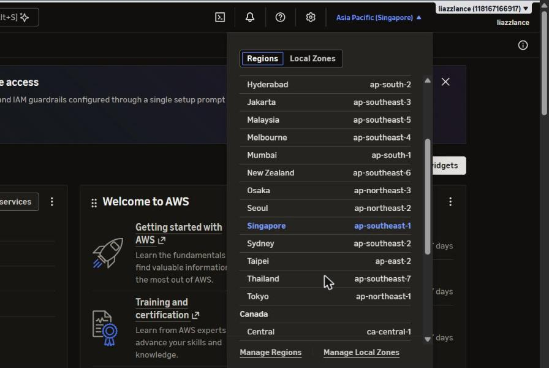

## 1. AWS account and IAM user
An AWS account and an **IAM user with administrator permissions** for the lab. Do not use the root user for daily work.

If you do not have one: **IAM → Users → Create user**, name `lab-admin`, tick **Provide user access to the AWS Management Console**, then **Attach policies directly → AdministratorAccess → Create user**. Sign in again with the console sign-in URL shown at the end, and turn on MFA for both the root user and this user.

## 2. Select the region
At the top right of the console, choose **Asia Pacific (Singapore) ap-southeast-1** and keep it for the whole workshop. It is the closest region to Vietnam, so uploads are fast.

## 3. Create a cost alert
1. **Billing and Cost Management → Budgets → Create budget**.
2. **Use a template** → **Monthly cost budget**, amount **5** USD, your email → **Create budget**.

## 4. Note your account ID
Click your user name at the top right and copy the 12-digit **Account ID**. IAM policies in this workshop use it.

## 5. Prepare test images
A few phone photos (JPEG) and one PNG with a transparent background, each under 10 MB.

## 6. Names used in this workshop
Policies and environment variables refer to these names, so keep them exactly:

| Resource | Name |
| --- | --- |
| Image bucket | `snapthumb-images-<yourname>` |
| Website bucket | `snapthumb-web-<yourname>` |
| DynamoDB table | `snapthumb-images` |
| Lambda functions | `snapthumb-thumbnail`, `snapthumb-api` |
| Lambda layer | `pillow-py312` |
| HTTP API | `snapthumb-api` |
| SNS topic (alerts) | `snapthumb-alarms` |

Replace the placeholders everywhere you see them:

| Placeholder | Replace with | Example |
| --- | --- | --- |
| `<yourname>` / `YOURNAME` | a short lowercase name, no accents or spaces (bucket names are global) | `minhquan` |
| `ACCOUNT_ID` | your 12-digit account ID (step 4) | `123456789012` |
| `https://abc123.execute-api…` | the Invoke URL of your API (5.6.2) | |
| `DISTRIBUTION_ID` | the ID of your CloudFront distribution (5.7) | `E1A2B3C4D5E6F7` |

## 7. AWS CloudShell
Command-line steps (packaging Pillow, testing with curl, deploying with CloudFormation) run in **CloudShell**: the `>_` icon in the console's top bar. It already has the AWS CLI, Python 3 and pip, and is signed in as your user, so nothing needs installing on your computer.
