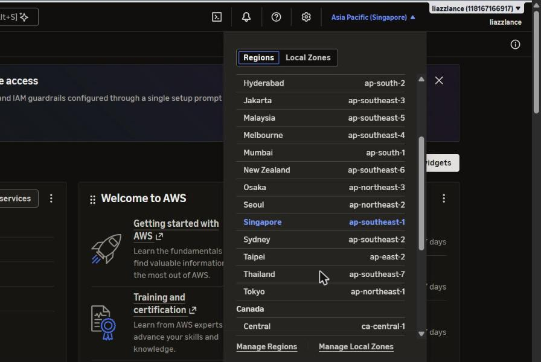

## 1. Tài khoản AWS và IAM user
Một tài khoản AWS và một **IAM user có quyền quản trị** để làm lab. Không dùng root user cho công việc hằng ngày.

Nếu chưa có: **IAM → Users → Create user**, đặt tên `lab-admin`, chọn **Provide user access to the AWS Management Console**, rồi **Attach policies directly → AdministratorAccess → Create user**. Đăng nhập lại bằng đường dẫn đăng nhập console hiện ở bước cuối, và bật MFA cho cả root user lẫn user này.

## 2. Chọn region
Ở góc trên bên phải console, chọn **Asia Pacific (Singapore) ap-southeast-1** và giữ nguyên trong suốt workshop. Đây là region gần Việt Nam nhất nên upload ảnh nhanh.

## 3. Tạo cảnh báo chi phí
1. **Billing and Cost Management → Budgets → Create budget**.
2. **Use a template** → **Monthly cost budget**, nhập **5** USD và email → **Create budget**.

## 4. Ghi lại Account ID
Bấm vào tên user ở góc trên bên phải và sao chép **Account ID** 12 chữ số. Các IAM policy trong workshop sẽ dùng số này.

## 5. Chuẩn bị ảnh thử
Vài ảnh chụp điện thoại (JPEG) và một ảnh PNG nền trong suốt, mỗi ảnh dưới 10 MB.

## 6. Tên dùng trong workshop
IAM policy và biến môi trường đều tham chiếu tới các tên này, nên hãy đặt đúng:

| Tài nguyên | Tên |
| --- | --- |
| Bucket ảnh | `snapthumb-images-<ten-ban>` |
| Bucket website | `snapthumb-web-<ten-ban>` |
| Bảng DynamoDB | `snapthumb-images` |
| Hàm Lambda | `snapthumb-thumbnail`, `snapthumb-api` |
| Lambda layer | `pillow-py312` |
| HTTP API | `snapthumb-api` |
| SNS topic (cảnh báo) | `snapthumb-alarms` |

Thay các chỗ giữ chỗ ở mọi nơi bạn gặp:

| Chỗ giữ chỗ | Thay bằng | Ví dụ |
| --- | --- | --- |
| `<ten-ban>` / `YOURNAME` | một tên ngắn, chữ thường, không dấu, không khoảng trắng (tên bucket là duy nhất toàn cầu) | `minhquan` |
| `ACCOUNT_ID` | Account ID 12 chữ số (bước 4) | `123456789012` |
| `https://abc123.execute-api…` | Invoke URL của API (5.6.2) | |
| `DISTRIBUTION_ID` | ID của CloudFront distribution (5.7) | `E1A2B3C4D5E6F7` |

## 7. AWS CloudShell
Các bước dòng lệnh (đóng gói Pillow, thử API bằng curl, deploy bằng CloudFormation) chạy trong **CloudShell**: biểu tượng `>_` trên thanh trên cùng của console. CloudShell có sẵn AWS CLI, Python 3 và pip, và đã đăng nhập bằng user của bạn, nên không cần cài gì trên máy.
