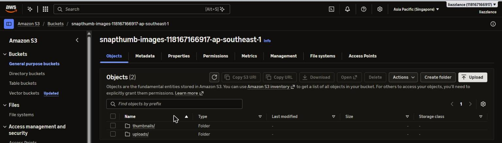

## Tạo bucket
1. **Amazon S3 → Create bucket**, loại **General purpose**.
2. **Bucket name:** `snapthumb-images-<ten-ban>` (tên bucket là duy nhất toàn cầu).
3. Giữ nguyên **Block all public access**: ảnh chỉ được xem qua link có thời hạn.
4. **Create bucket**.

## Tạo hai thư mục
Mở bucket → **Create folder** → `uploads`, rồi làm lại với `thumbnails`.



*Ảnh chụp từ bản deploy bằng CloudFormation (mục 5.9) nên tên tài nguyên có thêm hậu tố ngẫu nhiên.*

## Cấu hình CORS
Trình duyệt upload thẳng vào bucket này, mà bucket có địa chỉ khác với trang web, nên bucket phải cho phép.

Tab **Permissions** → **Cross-origin resource sharing (CORS)** → **Edit** → dán nội dung dưới đây → **Save changes**.

```json
[
  {
    "AllowedOrigins": ["*"],
    "AllowedMethods": ["POST", "GET"],
    "AllowedHeaders": ["*"],
    "MaxAgeSeconds": 3600
  }
]
```

{}
`"*"` cho phép mọi trang web, chấp nhận được khi demo. Khi chạy thật, hãy thay bằng địa chỉ trang web của bạn, ví dụ `https://d1234abcd.cloudfront.net` ở mục 5.7.
{}
