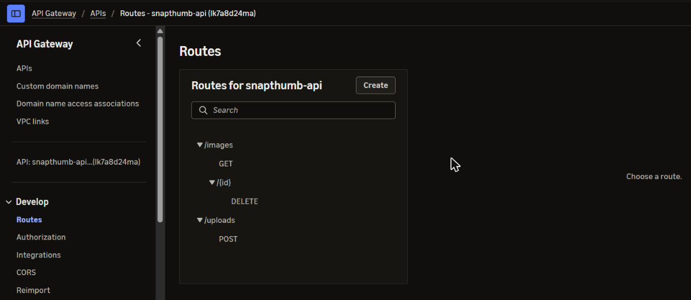

## Step 1: Create the API
1. **API Gateway → Create API → HTTP API → Build**.
2. **Add integration → Lambda** → `snapthumb-api`. **API name:** `snapthumb-api` → **Next**.
3. **Configure routes:** add three routes, each with target `snapthumb-api`:
   - `POST` `/uploads`
   - `GET` `/images`
   - `DELETE` `/images/{id}`
4. Stage `$default` with **Auto-deploy** → **Next → Create**.



*Screenshot from the CloudFormation deployment (5.9), so resource names carry a random suffix.*

## Step 2: CORS
**CORS → Configure:** Allow origin `*`, Allow methods `GET, POST, DELETE`, Allow headers `content-type` → **Save**.

## Step 3: Throttling
**Throttling → Edit** the `$default` stage: rate `10`, burst `20`.

## Step 4: Test with curl
Copy the **Invoke URL** (on the API's main page, or **Stages → $default**) and run in CloudShell:

```bash
API=https://abc123.execute-api.ap-southeast-1.amazonaws.com
curl -s "$API/images"; echo
curl -s -X POST "$API/uploads" -H "content-type: application/json" \
  -d '{"filename":"test.jpg","contentType":"image/jpeg","size":12345}'; echo
```

The first call returns `{"images": [...]}`; the second returns an `id` and an `upload` object with `url` and `fields`.

The second call created a `PENDING` record for `test.jpg` without uploading any file. Delete it so the web page does not show a card stuck at "Processing" (replace `ID` with the `id` you received; `204` means deleted):

```bash
curl -s -o /dev/null -w "%{http_code}\n" -X DELETE "$API/images/ID"
```
