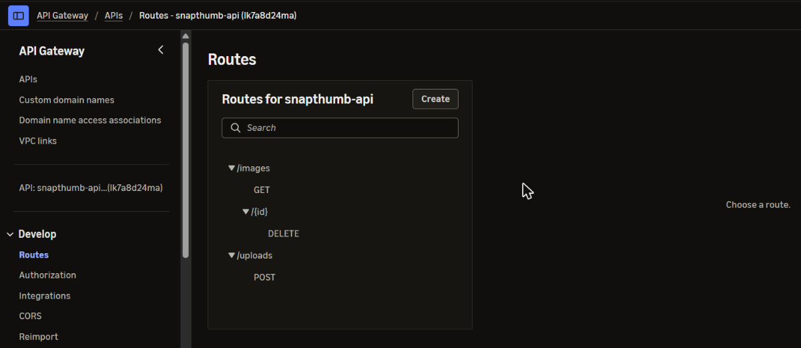

## Bước 1: Tạo API
1. **API Gateway → Create API → HTTP API → Build**.
2. **Add integration → Lambda** → `snapthumb-api`. **API name:** `snapthumb-api` → **Next**.
3. **Configure routes:** thêm ba route, đều trỏ tới `snapthumb-api`:
   - `POST` `/uploads`
   - `GET` `/images`
   - `DELETE` `/images/{id}`
4. Stage `$default` bật **Auto-deploy** → **Next → Create**.



*Ảnh chụp từ bản deploy bằng CloudFormation (mục 5.9) nên tên tài nguyên có thêm hậu tố ngẫu nhiên.*

## Bước 2: CORS
**CORS → Configure:** Allow origin `*`, Allow methods `GET, POST, DELETE`, Allow headers `content-type` → **Save**.

## Bước 3: Giới hạn tần suất
**Throttling → Edit** stage `$default`: rate `10`, burst `20`.

## Bước 4: Thử bằng curl
Sao chép **Invoke URL** (ở trang chính của API, hoặc **Stages → $default**) rồi chạy trong CloudShell:

```bash
API=https://abc123.execute-api.ap-southeast-1.amazonaws.com
curl -s "$API/images"; echo
curl -s -X POST "$API/uploads" -H "content-type: application/json" \
  -d '{"filename":"test.jpg","contentType":"image/jpeg","size":12345}'; echo
```

Lệnh đầu trả về `{"images": [...]}`; lệnh sau trả về `id` và đối tượng `upload` gồm `url` và `fields`.

Lệnh thứ hai đã tạo một bản ghi `PENDING` cho `test.jpg` mà không upload file nào. Hãy xoá bản ghi này để trang web không hiện thẻ đứng mãi ở "Đang xử lý" (thay `ID` bằng `id` vừa nhận; `204` nghĩa là đã xoá):

```bash
curl -s -o /dev/null -w "%{http_code}\n" -X DELETE "$API/images/ID"
```
