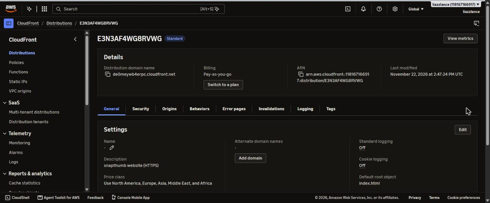
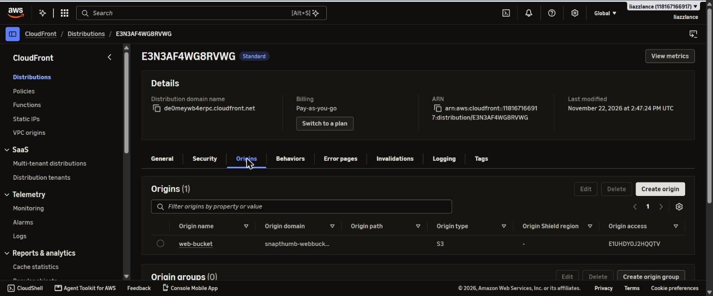
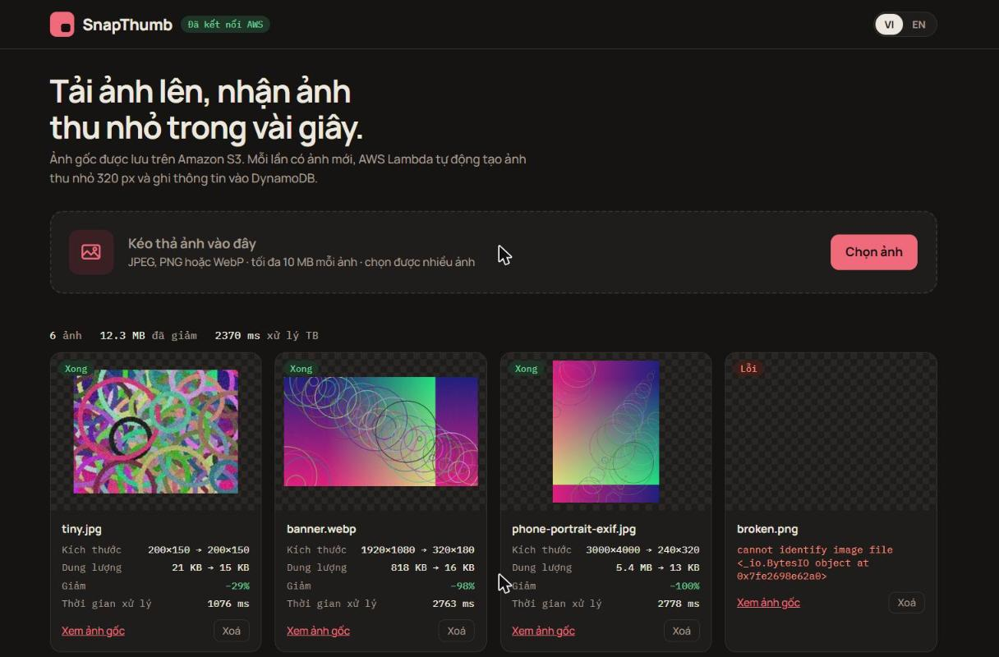

The page is stored in a **private** S3 bucket and served over **HTTPS** by **Amazon CloudFront**. CloudFront reads the bucket through **Origin Access Control (OAC)**, so nobody can open the bucket directly: the only way in is the CloudFront link.

```
Browser ──HTTPS──► CloudFront ──(OAC, signed request)──► S3 web bucket (private)
```

## Step 1: Private website bucket
1. **S3 → Create bucket** `snapthumb-web-<your-name>`, same Region as the rest of the lab.
2. Keep **Block all public access** ticked (the default) and create the bucket. Do **not** turn on *Static website hosting*; CloudFront does that job.

## Step 2: Upload the page
1. Download the source package [snapthumb.zip](/files/snapthumb.zip) and take `web/index.html` from it.
2. Create `config.js` next to it with your Invoke URL:

```js
window.SNAPTHUMB_CONFIG = { apiUrl: "https://abc123.execute-api.ap-southeast-1.amazonaws.com" };
```

3. Upload both files to the root of the bucket.

## Step 3: CloudFront distribution with OAC
1. **CloudFront → Create distribution.** If the console asks for a pricing plan, pick the free plan or *Pay as you go*; either works for this lab.
2. **Origin:** choose *Amazon S3* and pick the bucket `snapthumb-web-<your-name>` from the list (the REST endpoint, **not** an `s3-website` address).
3. **Origin access:** choose **Origin access control settings (recommended)** and create a new OAC with the default settings (*Sign requests*). In the newer console this is the option *Allow private S3 bucket access to CloudFront*.
4. **Default cache behavior:** *Viewer protocol policy* = **Redirect HTTP to HTTPS**, allowed methods **GET, HEAD**, cache policy **CachingOptimized**.
5. **Settings:** *Default root object* = `index.html`. WAF is not needed for this lab.
6. Create the distribution. If the console offers to **update the bucket policy** for you, accept. Otherwise copy the policy it shows into **S3 → bucket → Permissions → Bucket policy**. It looks like this:

```json
{
  "Version": "2012-10-17",
  "Statement": [
    {
      "Sid": "AllowCloudFrontOnly",
      "Effect": "Allow",
      "Principal": { "Service": "cloudfront.amazonaws.com" },
      "Action": "s3:GetObject",
      "Resource": "arn:aws:s3:::snapthumb-web-YOURNAME/*",
      "Condition": {
        "StringEquals": {
          "AWS:SourceArn": "arn:aws:cloudfront::ACCOUNT_ID:distribution/DISTRIBUTION_ID"
        }
      }
    }
  ]
}
```

7. Wait until **Last modified** shows a date instead of *Deploying* (about 5 minutes), then open `https://<distribution-domain>.cloudfront.net`.





{}
**Why the extra step?** A public bucket lets anyone list or download objects straight from S3, and the S3 website endpoint only speaks plain HTTP. With CloudFront + OAC the bucket stays fully private, the page gets HTTPS with an AWS certificate, and files are cached at edge locations close to the user. The `AWS:SourceArn` condition means only **your** distribution can read the bucket.
{}

{}
CloudFront caches files. After you upload a new `index.html` or `config.js`, open **CloudFront → distribution → Invalidations → Create invalidation**, enter `/*`, and reload the page. The `deploy.sh` script does this for you. If the page shows **AccessDenied**, check the bucket policy (distribution ID) and that *Default root object* is `index.html`.
{}

**Check:** `https://<distribution-domain>.cloudfront.net` opens the page with a padlock, while the bucket URL `https://snapthumb-web-<your-name>.s3.amazonaws.com/index.html` returns **AccessDenied**.

## How the page uses the API

1. For each chosen file it calls `POST /uploads` and receives `upload.url` and `upload.fields`.
2. It builds a `FormData` with every field, then the file **last** (S3 requires this order), and posts it to `upload.url`.
3. It calls `GET /images` every 1.5 seconds while any image is `PENDING`, and shows the thumbnail when it turns `DONE`.



{}
Without `config.js` the page runs in demo mode and shrinks images in the browser. The badge at the top says which mode you are in.
{}
