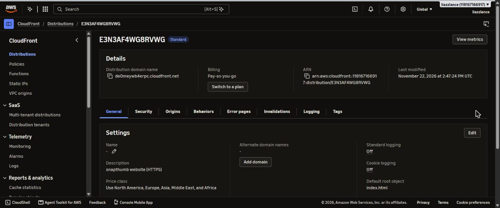
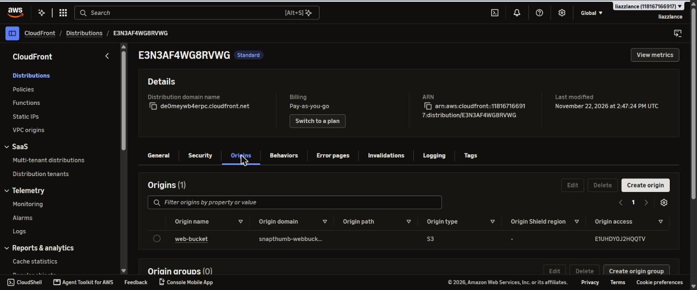
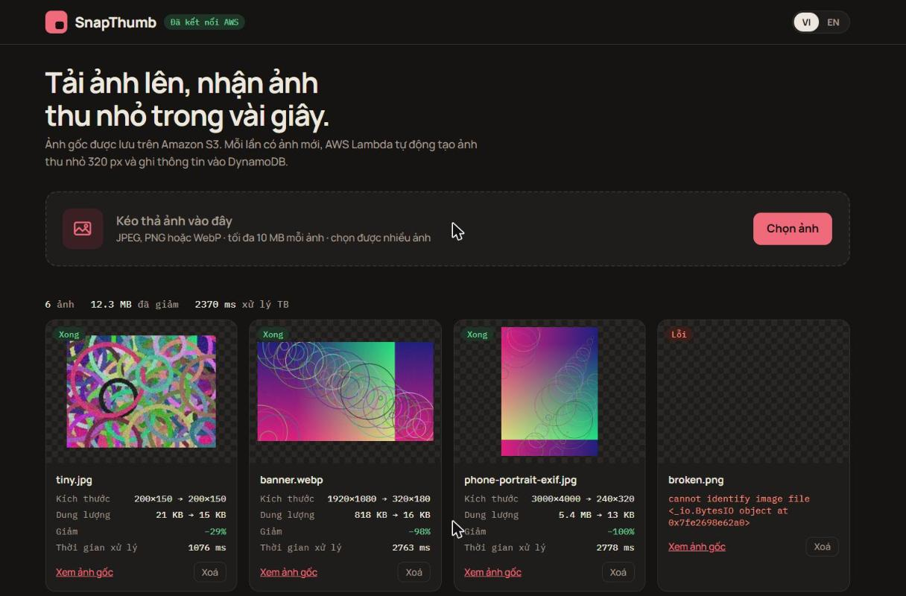

Trang web được lưu trong một bucket S3 **riêng tư** và phục vụ qua **HTTPS** bằng **Amazon CloudFront**. CloudFront đọc bucket thông qua **Origin Access Control (OAC)**, nên không ai mở được bucket trực tiếp: cách duy nhất là đi qua link CloudFront.

```
Trình duyệt ──HTTPS──► CloudFront ──(OAC, request có chữ ký)──► Bucket web S3 (riêng tư)
```

## Bước 1: Bucket website riêng tư
1. **S3 → Create bucket** `snapthumb-web-<ten-ban>`, cùng Region với các phần khác của bài lab.
2. Giữ nguyên **Block all public access** (mặc định đã chọn) rồi tạo bucket. **Không** bật *Static website hosting*; việc này CloudFront đảm nhận.

## Bước 2: Tải trang web lên
1. Tải gói mã nguồn [snapthumb.zip](/files/snapthumb.zip) và lấy file `web/index.html` trong đó.
2. Tạo file `config.js` cùng thư mục, điền Invoke URL của bạn:

```js
window.SNAPTHUMB_CONFIG = { apiUrl: "https://abc123.execute-api.ap-southeast-1.amazonaws.com" };
```

3. Upload cả hai file vào thư mục gốc của bucket.

## Bước 3: Tạo CloudFront distribution với OAC
1. **CloudFront → Create distribution.** Nếu console hỏi chọn gói giá (pricing plan), chọn gói miễn phí hoặc *Pay as you go*; gói nào cũng dùng được cho bài lab.
2. **Origin:** chọn *Amazon S3* và chọn bucket `snapthumb-web-<ten-ban>` trong danh sách (endpoint REST, **không** phải địa chỉ `s3-website`).
3. **Origin access:** chọn **Origin access control settings (recommended)** và tạo OAC mới với thiết lập mặc định (*Sign requests*). Ở console mới, tuỳ chọn này có tên *Allow private S3 bucket access to CloudFront*.
4. **Default cache behavior:** *Viewer protocol policy* = **Redirect HTTP to HTTPS**, allowed methods **GET, HEAD**, cache policy **CachingOptimized**.
5. **Settings:** *Default root object* = `index.html`. Bài lab không cần bật WAF.
6. Tạo distribution. Nếu console đề nghị **tự cập nhật bucket policy**, đồng ý. Nếu không, chép policy mà console hiển thị vào **S3 → bucket → Permissions → Bucket policy**. Policy có dạng:

```json
{
  "Version": "2012-10-17",
  "Statement": [
    {
      "Sid": "AllowCloudFrontOnly",
      "Effect": "Allow",
      "Principal": { "Service": "cloudfront.amazonaws.com" },
      "Action": "s3:GetObject",
      "Resource": "arn:aws:s3:::snapthumb-web-YOURNAME/*",
      "Condition": {
        "StringEquals": {
          "AWS:SourceArn": "arn:aws:cloudfront::ACCOUNT_ID:distribution/DISTRIBUTION_ID"
        }
      }
    }
  ]
}
```

7. Đợi cột **Last modified** hiện ngày giờ thay cho *Deploying* (khoảng 5 phút), rồi mở `https://<distribution-domain>.cloudfront.net`.





{}
**Vì sao cần thêm bước này?** Bucket public cho phép bất kỳ ai tải file trực tiếp từ S3, và website endpoint của S3 chỉ chạy HTTP. Với CloudFront + OAC, bucket giữ hoàn toàn riêng tư, trang web có HTTPS với chứng chỉ của AWS, và file được cache ở edge location gần người dùng. Điều kiện `AWS:SourceArn` đảm bảo chỉ **distribution của bạn** đọc được bucket.
{}

{}
CloudFront có cache. Sau khi upload `index.html` hoặc `config.js` mới, vào **CloudFront → distribution → Invalidations → Create invalidation**, nhập `/*` rồi tải lại trang. Script `deploy.sh` tự làm bước này. Nếu trang báo **AccessDenied**, kiểm tra bucket policy (đúng distribution ID) và *Default root object* là `index.html`.
{}

**Kiểm tra:** `https://<distribution-domain>.cloudfront.net` mở được trang và có biểu tượng ổ khoá, còn link bucket `https://snapthumb-web-<ten-ban>.s3.amazonaws.com/index.html` trả về **AccessDenied**.

## Trang web dùng API như thế nào

1. Với mỗi file được chọn, trang gọi `POST /uploads` và nhận về `upload.url` cùng `upload.fields`.
2. Trang tạo `FormData` gồm tất cả các field, rồi đặt file **cuối cùng** (S3 yêu cầu đúng thứ tự này), và gửi tới `upload.url`.
3. Trang gọi `GET /images` mỗi 1,5 giây khi còn ảnh `PENDING`, và hiện thumbnail khi ảnh chuyển sang `DONE`.



{}
Nếu không có `config.js`, trang chạy chế độ demo và thu nhỏ ảnh ngay trong trình duyệt. Huy hiệu ở đầu trang cho biết đang ở chế độ nào.
{}
