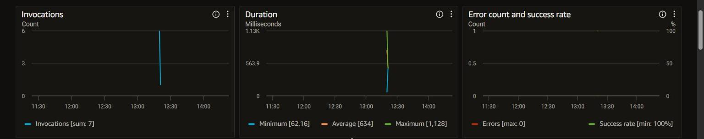

## Functional tests

| # | Test | Expected |
| --- | --- | --- |
| 1 | Upload a phone photo (JPEG) | `DONE` within a few seconds, thumbnail 320 px on the long edge |
| 2 | Upload a portrait photo | Thumbnail is upright and taller than wide |
| 3 | Upload a transparent PNG | Thumbnail has a white background |
| 4 | Upload 5 images at once | All five finish; Lambda runs them in parallel |
| 5 | Upload a `.txt` renamed to `.png` | Card shows `FAILED` with the error |
| 6 | Choose a 12 MB image | Page refuses it before upload |
| 7 | Delete an image | Card disappears; both files are gone from S3 |

## Measurements
Measured on AWS (ap-southeast-1, 18/11/2026). Six test images were uploaded **at the same time** from a client that uses the API and presigned POST exactly like the web page.

| Image | Original | Thumbnail | File size | Saved | Processing time |
| --- | --- | --- | --- | --- | --- |
| Landscape JPEG | 4032×3024 | 320×240 | 6.1 MB → 12.7 KB | 99.8% | 2,686 ms |
| Portrait JPEG (EXIF rotate 90°) | 3000×4000 | 240×320, upright | 5.4 MB → 12.5 KB | 99.8% | 2,778 ms |
| Transparent PNG | 1200×1200 | 320×320, white background | 11.4 KB → 5.2 KB | 53.9% | 2,547 ms |
| WebP | 1920×1080 | 320×180 | 818 KB → 16.4 KB | 98.0% | 2,763 ms |
| Small JPEG | 200×150 | 200×150 (not enlarged) | 21.0 KB → 14.9 KB | 29.1% | 1,076 ms |
| Text file renamed `.png` | – | – | – | – | `FAILED`: *cannot identify image file* |

**Cold start vs warm.** The times above include S3 event delivery and a *cold start*: the first run of each Lambda instance spends about **0.4 s** loading Python and Pillow (`Init Duration` in the log). On an instance that is already warm, a 6 MB photo took **0.48 s** of function time. Peak memory was **213 MB** out of 1024 MB; the extra memory is kept because Lambda gives more CPU with more memory.

| Other check | Result |
| --- | --- |
| API rejects GIF / declared size 11 MB | `400` |
| Client declares 1 KB but sends 10.5 MB | S3 refuses: `400 EntityTooLarge` |
| CORS preflight `OPTIONS /uploads` | `204`, `Access-Control-Allow-Origin: *` |
| Image uploaded straight to S3 (step 5.5) then `GET /images` | `200`, image listed; `DELETE` → `204`, both files removed |

{}
Repeat the table with your own phone photos: the page shows the size, savings and processing time on each card.
{}

## Monitoring
1. **Lambda → snapthumb-thumbnail → Monitor**: invocations, duration, errors.
2. **CloudWatch → Log groups → /aws/lambda/snapthumb-thumbnail**: one log line per image with sizes before and after.

## Common errors

| Symptom | Cause | Fix |
| --- | --- | --- |
| `No module named 'PIL'` in the log | Layer not attached, or built for the wrong platform | Attach `pillow-py312` (5.5.2); rebuild with the exact command in 5.5.1 |
| Stuck at "Processing" | Missing S3 trigger or wrong prefix | Check the trigger has prefix `uploads/` |
| `AccessDenied` in the log | Inline policy has the wrong bucket name or account ID | Fix `YOURNAME` / `ACCOUNT_ID` |
| CORS error in the browser on upload | Bucket CORS missing | Add the CORS rules (5.3) |
| CORS error on `/images` | API CORS missing | Configure CORS on the API (5.6.2) |
| S3 answers `400 EntityTooLarge` on upload | File larger than 10 MB (the presigned POST allows at most 10 MB) | Choose a smaller file |
| S3 answers `403` on upload | Upload link expired (valid 5 minutes) | Upload again: the page asks for a new link |
| A card stays at "Processing" after a failed upload | Old page version kept the `PENDING` record | Use the current `index.html`: it deletes the record when the upload fails and stops polling after 2 minutes |

## Limitations and next steps

SnapThumb is a demo. These are known limitations and how AWS services would address them:

| Limitation | Risk | Next step |
| --- | --- | --- |
| The API has no sign-in | Anyone who knows the API address can list and **delete every image** | Add an **Amazon Cognito** user pool and a JWT authorizer on the HTTP API; store `userId` with each image |
| The website is a public S3 website endpoint (HTTP only) | No HTTPS; the account must allow public bucket policies | Private bucket behind **Amazon CloudFront** with Origin Access Control, HTTPS, and **AWS WAF** |
| `GET /images` scans the whole table | Gets slower and costlier as images grow | Add a GSI on `createdAt` (or per-user key) and use `Query` with pagination |
| Monitoring is manual (Monitor tab, logs) | Errors are noticed late | **CloudWatch alarms** on Lambda `Errors` and API `5xx` that email through **Amazon SNS** |
| A failed thumbnail is not retried | A temporary error leaves the image `FAILED` | Configure an on-failure destination / **SQS dead-letter queue** and retry |
