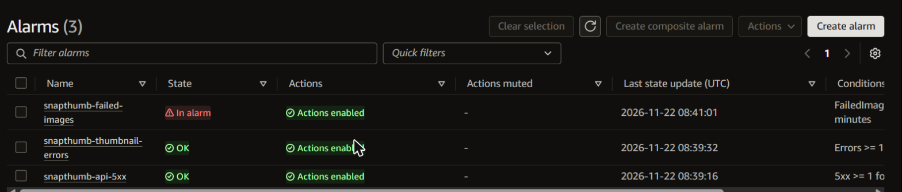

## Kiểm thử chức năng

| # | Kiểm thử | Kết quả mong đợi |
| --- | --- | --- |
| 1 | Upload ảnh chụp điện thoại (JPEG) | `DONE` sau vài giây, thumbnail cạnh dài 320 px |
| 2 | Upload ảnh chụp dọc | Thumbnail đúng chiều, cao hơn rộng |
| 3 | Upload ảnh PNG nền trong suốt | Thumbnail có nền trắng |
| 4 | Upload 5 ảnh cùng lúc | Cả năm ảnh đều xong; Lambda chạy song song |
| 5 | Upload file `.txt` đổi đuôi thành `.png` | Thẻ ảnh báo `FAILED` kèm lỗi |
| 6 | Chọn ảnh 12 MB | Trang từ chối ngay trước khi upload |
| 7 | Xoá một ảnh | Thẻ ảnh biến mất; cả hai file trên S3 bị xoá |

## Số liệu đo được
Đo trên AWS (ap-southeast-1, 18/11/2026). Sáu ảnh test được upload **cùng lúc** từ một client gọi API và presigned POST giống hệt trang web.

| Ảnh | Ảnh gốc | Thumbnail | Dung lượng | Giảm | Thời gian xử lý |
| --- | --- | --- | --- | --- | --- |
| JPEG ngang | 4032×3024 | 320×240 | 6,1 MB → 12,7 KB | 99,8% | 2.686 ms |
| JPEG dọc (EXIF xoay 90°) | 3000×4000 | 240×320, đúng chiều | 5,4 MB → 12,5 KB | 99,8% | 2.778 ms |
| PNG trong suốt | 1200×1200 | 320×320, nền trắng | 11,4 KB → 5,2 KB | 53,9% | 2.547 ms |
| WebP | 1920×1080 | 320×180 | 818 KB → 16,4 KB | 98,0% | 2.763 ms |
| JPEG nhỏ | 200×150 | 200×150 (không phóng to) | 21,0 KB → 14,9 KB | 29,1% | 1.076 ms |
| File text đổi đuôi `.png` | – | – | – | – | `FAILED`: *cannot identify image file* |

**Khởi động lạnh và khi đã chạy sẵn.** Thời gian trên gồm cả lúc S3 gửi sự kiện và *cold start*: lần chạy đầu của mỗi instance Lambda mất khoảng **0,4 giây** để nạp Python và Pillow (`Init Duration` trong log). Khi instance đã chạy sẵn, ảnh 6 MB chỉ mất **0,48 giây** thời gian chạy hàm. Bộ nhớ dùng tối đa **213 MB** trên 1024 MB; vẫn để 1024 MB vì Lambda cấp nhiều CPU hơn khi tăng bộ nhớ.

| Kiểm tra khác | Kết quả |
| --- | --- |
| API từ chối GIF / khai dung lượng 11 MB | `400` |
| Client khai 1 KB nhưng gửi 10,5 MB | S3 từ chối: `400 EntityTooLarge` |
| CORS preflight `OPTIONS /uploads` | `204`, `Access-Control-Allow-Origin: *` |
| Ảnh upload thẳng lên S3 (bước 5.5) rồi gọi `GET /images` | `200`, ảnh có trong danh sách; `DELETE` → `204`, xoá cả hai file |

{}
Hãy đo lại bảng này với ảnh chụp điện thoại của bạn: mỗi thẻ ảnh trên trang web đều hiện kích thước, mức giảm và thời gian xử lý.
{}

## Giám sát
1. **Lambda → snapthumb-thumbnail → Monitor**: số lần chạy, thời gian chạy, số lỗi.
2. **CloudWatch → Log groups → /aws/lambda/snapthumb-thumbnail**: mỗi ảnh một dòng log ghi dung lượng trước và sau.


## Cảnh báo (CloudWatch alarm + Amazon SNS)

Xem tab Monitor chỉ có tác dụng khi có người đang nhìn. Ba alarm dưới đây gửi email ngay khi có sự cố:

| Alarm | Metric | Báo động khi | Phát hiện điều gì |
| --- | --- | --- | --- |
| `snapthumb-thumbnail-errors` | `AWS/Lambda` → `Errors` của hàm thumbnail | ≥ 1 trong 5 phút | Hàm thumbnail bị lỗi, quá thời gian hoặc hết bộ nhớ |
| `snapthumb-api-5xx` | `AWS/ApiGateway` → `5xx` của HTTP API | ≥ 1 trong 5 phút | Lambda API gặp lỗi, người dùng thấy "Internal error" |
| `snapthumb-failed-images` | `SnapThumb` → `FailedImages` (metric filter đếm dòng log `Failed to process`) | ≥ 3 trong 5 phút | Nhiều file hỏng hoặc giả ảnh cùng lúc (bị lạm dụng hoặc client lỗi) |

Hàm thumbnail tự bắt file hỏng và đánh dấu `FAILED`, nên metric `Errors` có sẵn vẫn bằng 0 với các file này. **Metric filter** đếm các dòng log đó và biến chúng thành metric `FailedImages`.

#### Khi dùng CloudFormation (5.9)

Template đã có sẵn SNS topic, metric filter và ba alarm. Truyền email khi deploy, rồi bấm **Confirm subscription** trong thư AWS gửi tới:

```bash
ALARM_EMAIL=ban@example.com bash deploy.sh
```

#### Khi làm tay trên console

1. **Amazon SNS → Topics → Create topic**: loại **Standard**, tên `snapthumb-alarms`. Sau đó **Create subscription**: protocol **Email**, địa chỉ của bạn. Xác nhận email.
2. **CloudWatch → Log groups → `/aws/lambda/snapthumb-thumbnail` → Metric filters → Create metric filter**: pattern `"Failed to process"`, namespace `SnapThumb`, metric name `FailedImages`, metric value `1`, default value `0`.
3. **CloudWatch → Alarms → Create alarm** ba lần theo bảng trên: statistic **Sum**, period **5 minutes**, điều kiện **Greater/Equal**, gửi tới `snapthumb-alarms` ở cả trạng thái **In alarm** và **OK**. Ở *Missing data treatment* chọn **Treat missing data as good (not breaching threshold)**.

#### Kiểm thử cảnh báo

Upload ba file ảnh giả (file text đổi đuôi `.png`) trên trang web. Sau vài phút, `snapthumb-failed-images` chuyển sang **In alarm** và email được gửi tới; khi không còn ảnh lỗi mới, alarm trở về **OK** và có thêm một email xác nhận.

Kết quả trên AWS (ap-southeast-1, 22/11/2026): upload ba ảnh giả; `snapthumb-failed-images` chuyển từ **OK** sang **In alarm** sau **71 giây**, CloudWatch ghi nhận *Successfully executed action* tới SNS topic và email được gửi tới hộp thư. Không còn ảnh lỗi mới, alarm trở về **OK** sau 15 phút và gửi email thứ hai.



## Lỗi thường gặp

| Hiện tượng | Nguyên nhân | Cách sửa |
| --- | --- | --- |
| Log báo `No module named 'PIL'` | Chưa gắn layer, hoặc layer đóng gói sai nền tảng | Gắn `pillow-py312` (5.5.2); đóng gói lại đúng lệnh ở 5.5.1 |
| Ảnh đứng mãi ở "Đang xử lý" | Thiếu trigger S3 hoặc sai prefix | Kiểm tra trigger có prefix `uploads/` |
| Log báo `AccessDenied` | Inline policy sai tên bucket hoặc account ID | Sửa `YOURNAME` / `ACCOUNT_ID` |
| Lỗi CORS khi upload | Bucket chưa cấu hình CORS | Thêm CORS cho bucket (5.3) |
| Lỗi CORS khi gọi `/images` | API chưa cấu hình CORS | Cấu hình CORS cho API (5.6.2) |
| S3 trả `400 EntityTooLarge` khi upload | File lớn hơn 10 MB (presigned POST chỉ cho tối đa 10 MB) | Chọn file nhỏ hơn |
| S3 trả `403` khi upload | Link upload đã hết hạn (5 phút) | Upload lại: trang sẽ xin link mới |
| Thẻ ảnh đứng ở "Đang xử lý" sau khi upload lỗi | Trang bản cũ để lại bản ghi `PENDING` | Dùng `index.html` mới: trang xoá bản ghi khi upload lỗi và ngừng hỏi lại sau 2 phút |

## Khó khăn và cách giải quyết

| Khó khăn | Chuyện gì xảy ra | Cách giải quyết | Bài học |
| --- | --- | --- | --- |
| Đề tài bị chặn vì quota | Ý tưởng đầu tiên (chatbot trên Amazon Bedrock) không chạy được vì tài khoản mới có quota quá thấp | Chuyển sang SnapThumb, chỉ dùng các dịch vụ cốt lõi có hạn mức rộng | Kiểm tra quota dịch vụ trước khi chọn kiến trúc |
| Nguy cơ vòng lặp vô hạn | Hàm thumbnail ghi vào chính bucket kích hoạt nó | Trigger chỉ nghe tiền tố `uploads/`, thumbnail ghi vào `thumbnails/` | Tách tiền tố (hoặc bucket) đầu vào và đầu ra cho Lambda kích hoạt bởi S3 |
| Phụ thuộc vòng trong CloudFormation | Bucket cần quyền gọi Lambda, còn quyền đó lại cần ARN của bucket | Đặt tên bucket từ tên stack và account ID, cho bucket phụ thuộc vào quyền | Dùng tên đoán trước được để phá vòng phụ thuộc |
| Pillow cài trên máy cá nhân không chạy trên Lambda | Bản build cho Windows hoặc macOS không nạp được trên Amazon Linux | `pip install --platform manylinux… --python-version 3.12 --only-binary=:all:` trong CloudShell | Đóng gói thư viện native đúng runtime và kiến trúc của Lambda |
| Lỗi chỉ lộ ra trên AWS thật | Ảnh upload từ console S3 không có bản ghi từ API, nên `GET /images` lỗi 500 | Điền trường còn thiếu bằng `if_not_exists`, đọc trường tuỳ chọn bằng `.get()`, thêm 2 test hồi quy | Test giả lập chỉ kiểm tra những gì mình đã nghĩ tới; phải test đầu-cuối trên dịch vụ thật |
| Người dùng khai gian dung lượng file | Trình duyệt tự khai dung lượng; client có thể gửi file lớn hơn | Điều kiện `content-length-range` trong presigned POST: chính S3 từ chối file trên 10 MB (`400 EntityTooLarge`) | Kiểm tra giới hạn ở phía server, không chỉ trên giao diện |

## Hạn chế và hướng phát triển

SnapThumb là bản demo. Dưới đây là các hạn chế đã biết và dịch vụ AWS có thể dùng để khắc phục:

| Hạn chế | Rủi ro | Hướng phát triển |
| --- | --- | --- |
| API chưa có đăng nhập | Ai biết địa chỉ API cũng xem được và **xoá được mọi ảnh** | Thêm **Amazon Cognito** user pool và JWT authorizer cho HTTP API; lưu `userId` cùng mỗi ảnh |
| Trang web là S3 website endpoint public (chỉ HTTP) | Không có HTTPS; tài khoản phải cho phép bucket policy public | Bucket private đặt sau **Amazon CloudFront** với Origin Access Control, HTTPS và **AWS WAF** |
| `GET /images` quét toàn bộ bảng | Chậm và tốn hơn khi số ảnh tăng | Thêm GSI theo `createdAt` (hoặc theo người dùng) và dùng `Query` có phân trang |
| Thumbnail lỗi không được thử lại | Lỗi tạm thời khiến ảnh bị `FAILED` | Cấu hình on-failure destination / **SQS dead-letter queue** và thử lại |
