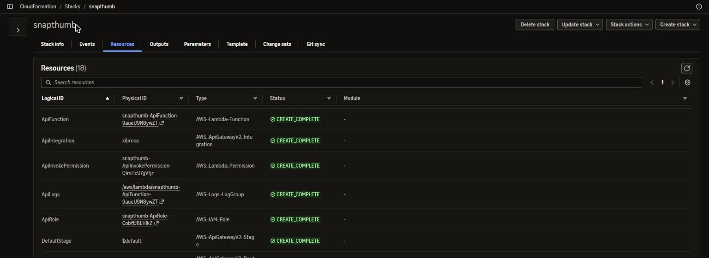

Everything in 5.3–5.7 can be created by one template. This is **Infrastructure as Code**: the system is described in a file, so it can be rebuilt identically, reviewed and versioned.

## What the template contains
`infra/template.yaml` in the source package creates: the image bucket (CORS, S3 trigger), the DynamoDB table, both Lambda functions with their IAM roles and log groups, the HTTP API with three routes and throttling, the website bucket, and the alerts (an SNS topic with an optional email subscription, a metric filter and three CloudWatch alarms). Its parameters:

| Parameter | Default | Meaning |
| --- | --- | --- |
| `ThumbnailMaxSize` | `320` | Longest edge of a thumbnail, 64–1024 px |
| `ThrottlingRateLimit` / `ThrottlingBurstLimit` | `10` / `20` | API request limit per second / burst |
| `AlarmEmail` | empty | Administrator email for alerts; `deploy.sh` fills it from `ALARM_EMAIL` |
| `FailedImagesThreshold` | `3` | Failed images within 5 minutes that trigger the alarm |

To change the other parameters, edit their `Default` in the template or pass `--parameter-overrides` to `aws cloudformation deploy`.

## A circular dependency to solve
The bucket's trigger needs the function, the function's permission needs the bucket's ARN, and the function's IAM policy also needs the bucket. Referencing the bucket resource from both would create a cycle CloudFormation refuses. The template breaks it by **building the bucket name from the stack name**: `${AWS::StackName}-images-${AWS::AccountId}-${AWS::Region}`. The permission and the policy use that string, not a reference to the bucket.

## Deploy with one command
Download [snapthumb.zip](/files/snapthumb.zip). In CloudShell choose **Actions → Upload file**, upload it, then run:

```bash
unzip -oq snapthumb.zip && cd snapthumb
export ALARM_EMAIL=you@example.com   # optional: receive alarm emails
bash deploy.sh
```

{}
Verified on a real account (ap-southeast-1, 18/11/2026): the template created all **18 resources** on the first attempt (table, 2 buckets + policy, 2 functions, 2 roles, 2 log groups, 2 permissions, HTTP API, integration, 3 routes, stage) in about 1–2 minutes. Adding the alerts on 22/11/2026 (SNS topic, email subscription, metric filter and 3 alarms) brought the stack to **24 resources**.
{}

`deploy.sh` runs four steps: create or update the stack; package the Thumbnail function with Pillow; upload both functions' code; upload the web page with `config.js` filled in. It prints the website address at the end.



## Automated tests
`backend/test_app.py` runs the whole flow against mocked AWS (moto): create an upload link, upload, run the thumbnail handler, list, delete, plus broken files, transparent PNGs, portrait and small images, and invalid input. Two regression tests cover images uploaded straight to S3 and records without file keys.

Run the tests on your computer or in CloudShell:

```bash
pip install "moto[s3,dynamodb]" Pillow
cd backend && python3 -m unittest -v
```
