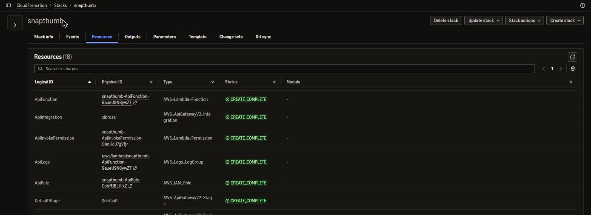

Toàn bộ những gì làm ở mục 5.3–5.7 có thể tạo bằng một template. Đây là **Infrastructure as Code**: hệ thống được mô tả trong file, nên dựng lại giống hệt được, xem lại được và quản lý phiên bản được.

## Template gồm những gì
`infra/template.yaml` trong gói mã nguồn tạo ra: bucket ảnh (CORS, trigger S3), bảng DynamoDB, hai hàm Lambda cùng IAM role và log group, HTTP API với ba route và giới hạn tần suất, và bucket website.

## Một phụ thuộc vòng cần giải
Trigger của bucket cần hàm Lambda, quyền gọi hàm cần ARN của bucket, và IAM policy của hàm cũng cần bucket. Nếu cả hai tham chiếu thẳng tới tài nguyên bucket sẽ tạo thành vòng, CloudFormation từ chối. Template giải bằng cách **tạo tên bucket từ tên stack**: `${AWS::StackName}-images-${AWS::AccountId}-${AWS::Region}`. Quyền gọi hàm và policy dùng chuỗi tên này thay vì tham chiếu tới bucket.

## Deploy bằng một lệnh
Tải [snapthumb.zip](/files/snapthumb.zip) về máy. Trong CloudShell chọn **Actions → Upload file** để upload, rồi chạy:

```bash
unzip -oq snapthumb.zip && cd snapthumb
export ALARM_EMAIL=you@example.com   # tuỳ chọn: nhận email cảnh báo
bash deploy.sh
```

{}
Đã kiểm chứng trên tài khoản thật (ap-southeast-1, 18/11/2026): template tạo đủ **18 tài nguyên** ngay lần đầu (bảng, 2 bucket + policy, 2 hàm, 2 role, 2 log group, 2 quyền gọi hàm, HTTP API, integration, 3 route, stage) trong khoảng 1–2 phút.
{}

`deploy.sh` chạy bốn bước: tạo hoặc cập nhật stack; đóng gói hàm Thumbnail kèm Pillow; upload code cho cả hai hàm; upload trang web với `config.js` đã điền sẵn. Cuối cùng script in ra địa chỉ trang web.



## Kiểm thử tự động
`backend/test_app.py` chạy toàn luồng trên AWS giả lập (moto): tạo link upload, upload, chạy hàm tạo thumbnail, liệt kê, xoá, cùng các trường hợp file hỏng, PNG trong suốt, ảnh dọc, ảnh nhỏ và dữ liệu đầu vào sai. Hai test hồi quy kiểm tra ảnh upload thẳng lên S3 và bản ghi thiếu khoá file.
