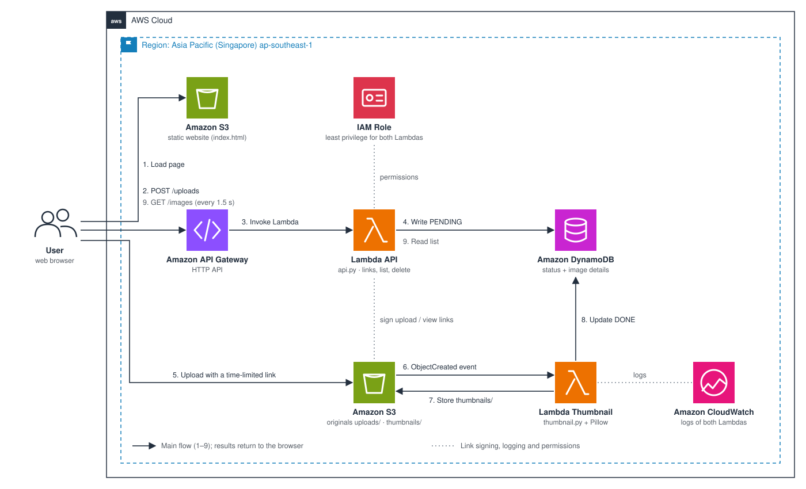

# Building SnapThumb: an event-driven thumbnail service on AWS

#### Overview

In this workshop you build **SnapThumb**: users upload images from a web page, and every new image in Amazon S3 automatically triggers AWS Lambda to create a 320 px thumbnail. Image details are stored in Amazon DynamoDB and served to the page through Amazon API Gateway.

You build it by hand in the AWS Management Console first, so you see what each service does. Section 5.9 then shows how the same system is created with one command using AWS CloudFormation.

| | |
| --- | --- |
| **Time** | About 2 hours |
| **Level** | Beginner (you need an AWS account and an IAM user) |
| **Cost** | A few cents; close to zero if you clean up afterwards |
| **Region** | Asia Pacific (Singapore) `ap-southeast-1` |

#### Content

1. [Workshop overview](5.1-workshop-overview/)
2. [Prerequisites](5.2-prerequiste/)
3. [Create the image bucket](5.3-s3-images/)
4. [Create the DynamoDB table](5.4-dynamodb/)
5. [Create the Thumbnail Lambda](5.5-thumbnail-lambda/)
6. [Create the API](5.6-api/)
7. [Host the web frontend](5.7-frontend/)
8. [Testing and monitoring](5.8-testing-monitoring/)
9. [Automate with CloudFormation](5.9-cloudformation/)
10. [Clean up resources](5.10-cleanup/)
