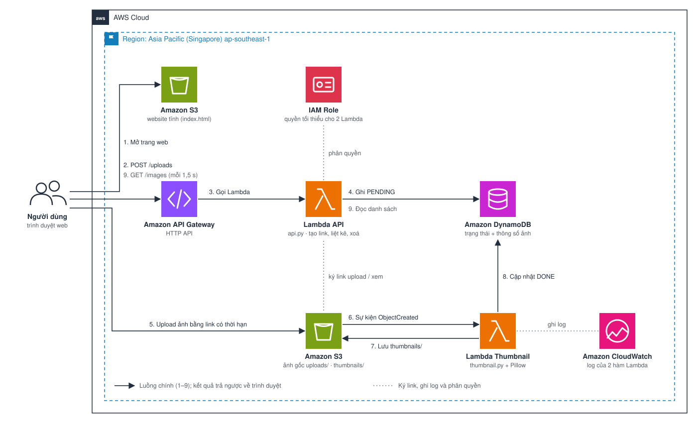

# Xây dựng SnapThumb: dịch vụ tạo ảnh thu nhỏ hướng sự kiện trên AWS

#### Tổng quan

Trong workshop này, bạn sẽ xây dựng **SnapThumb**: người dùng tải ảnh lên từ trang web, và mỗi ảnh mới trong Amazon S3 sẽ tự động kích hoạt AWS Lambda tạo ảnh thu nhỏ 320 px. Thông tin ảnh được lưu trong Amazon DynamoDB và trả về trang web qua Amazon API Gateway.

Bạn sẽ dựng hệ thống bằng tay trên AWS Management Console trước, để thấy rõ mỗi dịch vụ làm gì. Sau đó mục 5.9 cho thấy cách tạo toàn bộ hệ thống chỉ với một lệnh bằng AWS CloudFormation.

| | |
| --- | --- |
| **Thời gian** | Khoảng 2 giờ |
| **Mức độ** | Cơ bản (cần tài khoản AWS và một IAM user) |
| **Chi phí** | Vài cent; gần như bằng 0 nếu dọn dẹp sau khi làm |
| **Region** | Asia Pacific (Singapore) `ap-southeast-1` |

#### Nội dung

1. [Tổng quan workshop](5.1-workshop-overview/)
2. [Chuẩn bị](5.2-prerequiste/)
3. [Tạo bucket lưu ảnh](5.3-s3-images/)
4. [Tạo bảng DynamoDB](5.4-dynamodb/)
5. [Tạo Lambda tạo thumbnail](5.5-thumbnail-lambda/)
6. [Tạo API](5.6-api/)
7. [Đưa giao diện web lên S3](5.7-frontend/)
8. [Kiểm thử và giám sát](5.8-testing-monitoring/)
9. [Tự động hoá bằng CloudFormation](5.9-cloudformation/)
10. [Dọn dẹp tài nguyên](5.10-cleanup/)
